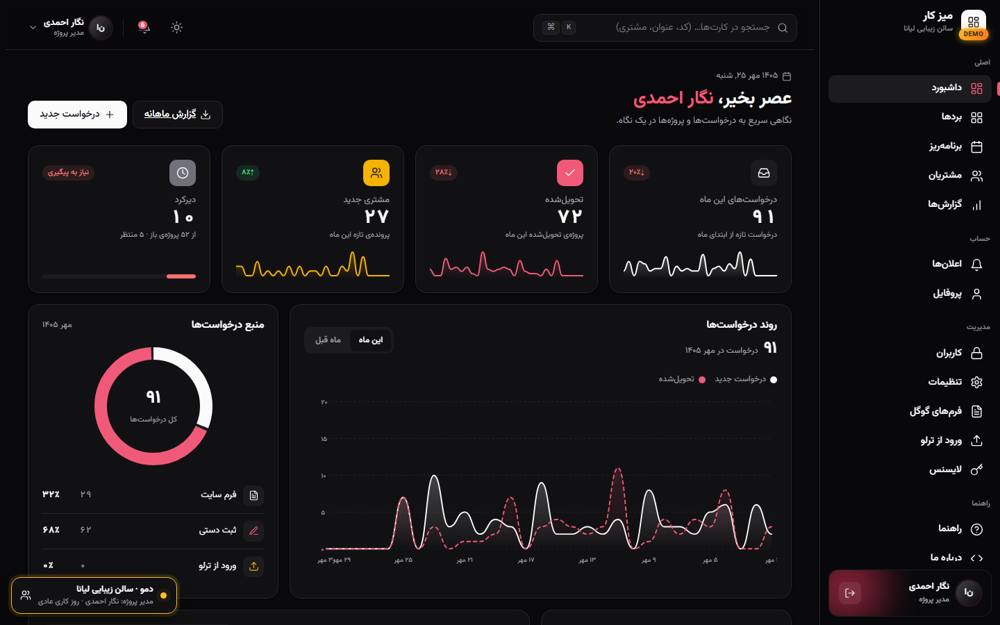
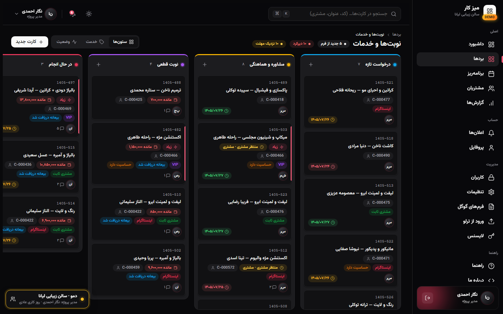
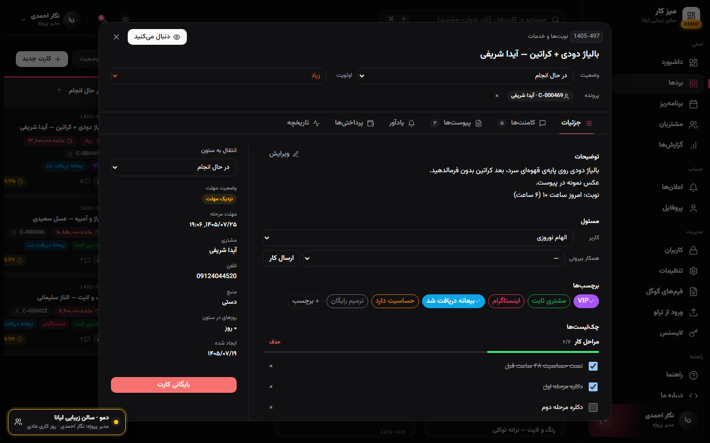
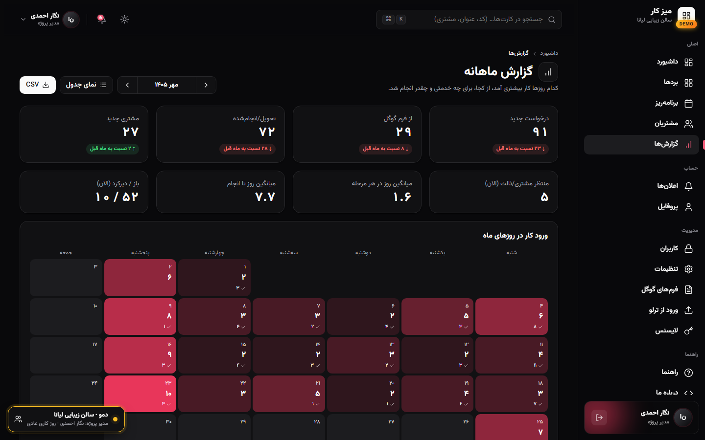
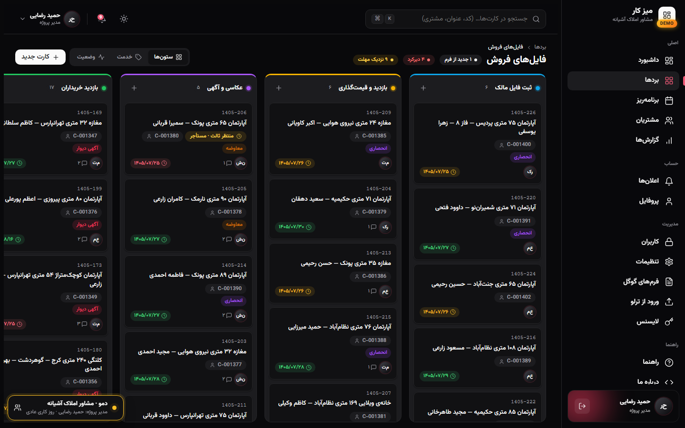
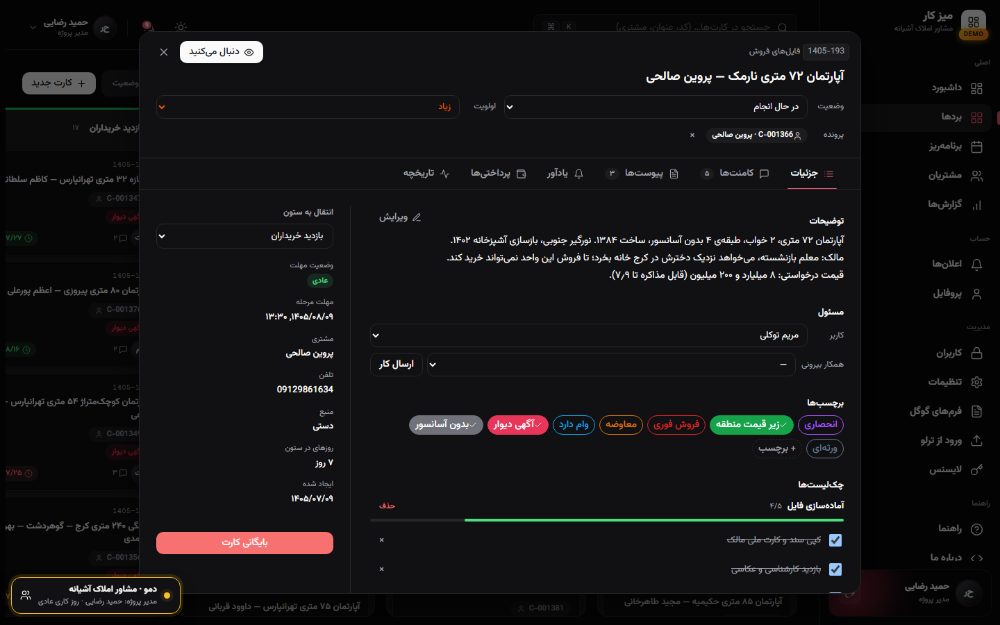
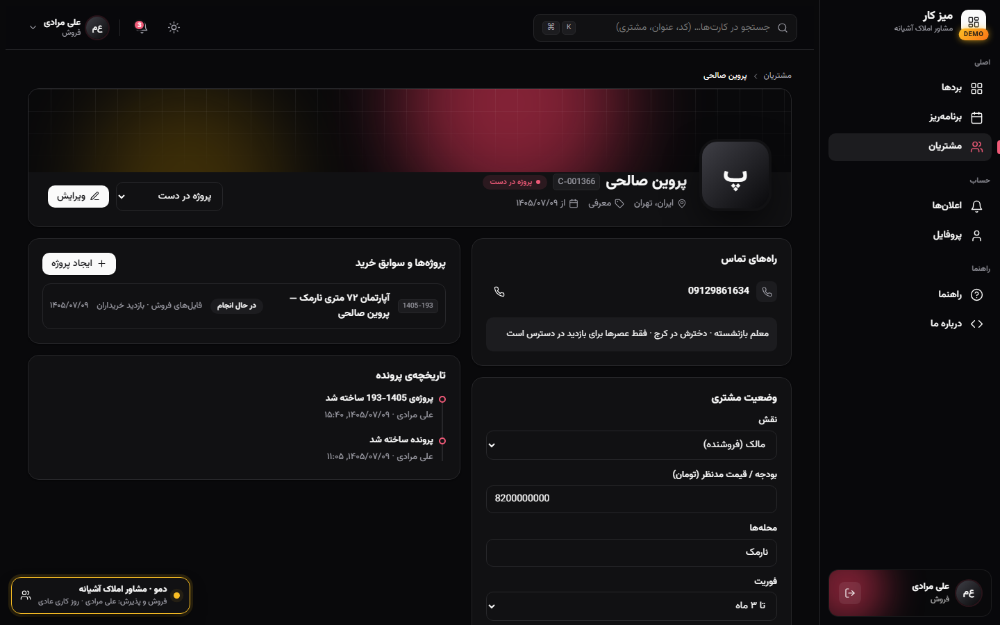
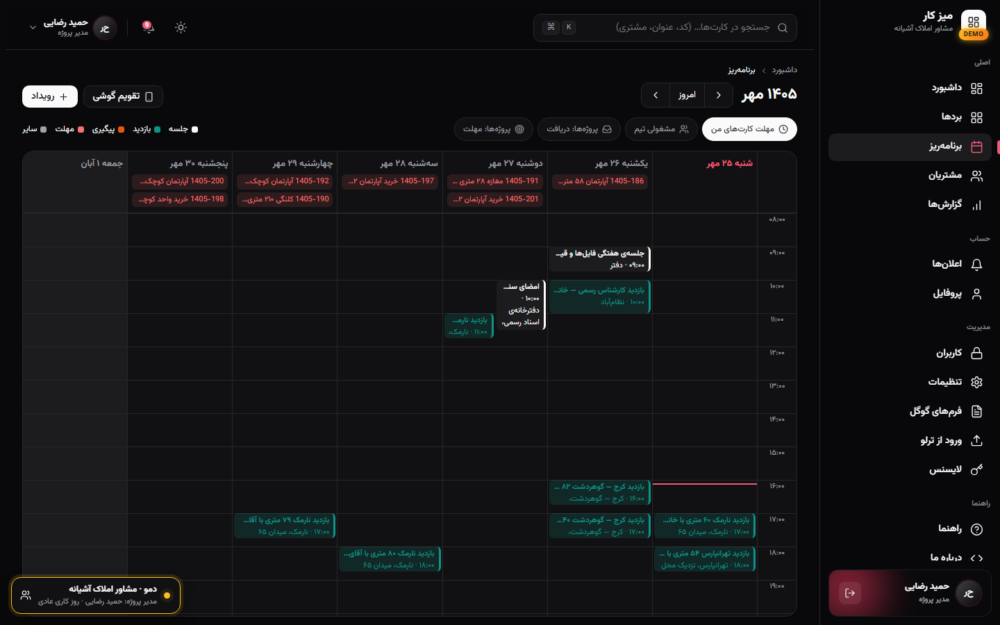
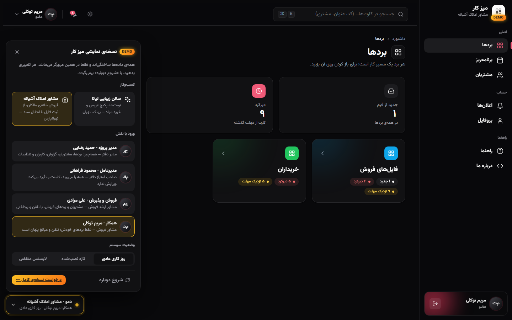
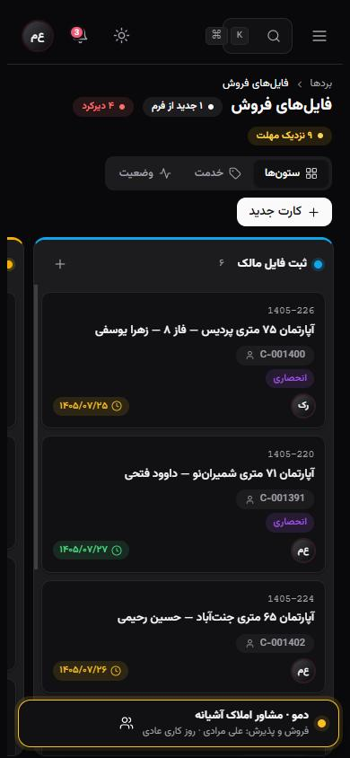

# Miz-e Kar — Workflow Dashboard

**Requests, projects, customers and payments for small businesses — in one Persian, right-to-left dashboard.** 
*Self-hosted on your own server. Your customers' data never leaves your office.*

### 🟢 [**→ Live Demo — try it now, no install needed**](https://javiddeveloper.github.io/workflow-sell-DEMO/)

[**Live Demo**](https://javiddeveloper.github.io/workflow-sell-DEMO/) • [**Three businesses**](#-three-businesses-four-roles) • [**Screenshots**](#-interface) • [**Capabilities**](#-core-capabilities) • [**Get it**](#-get-it-for-your-business)

---

## ⚡ What is Miz-e Kar?

Small businesses run on Instagram DMs, phone calls, a notebook and a Trello board nobody updates. Requests get lost, deposits are forgotten, and the owner cannot see what happened this month without asking everyone.

**Miz-e Kar** ("work desk") puts the whole flow in one place:

1. **Every request becomes a card** — from the website or Google Form, Instagram, a call or a walk-in — on a board that matches how *your* business works, with a deadline for each stage.
2. **Every customer has one file** — phones, history, notes, every project and every payment, found by any part of a phone number.
3. **Nothing is forgotten** — follow-ups repeat until someone marks them done; overdue work, payment balances and today's appointments are in front of the right person, on Bale, Telegram or email.
4. **The owner sees the month** — what came in, from where, which services sell, what was delivered and what is late.

> [!IMPORTANT]
> **Installed on your own server.** Customer phone numbers, national IDs and payments stay inside your business. Each role sees only what it should: a staff member never sees phone numbers or amounts unless you allow it.

---

## ⏱️ Try It in 60 Seconds

> **[→ Open the live demo](https://javiddeveloper.github.io/workflow-sell-DEMO/)** — runs entirely in your browser on built-in sample data. No server, no sign-up, nothing you type leaves your browser.

Use the **«دمو»** button in the corner to switch business, role and scenario at any time.

| Page | Link | What to look at |
|---|---|---|
| Dashboard | [overview](https://javiddeveloper.github.io/workflow-sell-DEMO/overview/?biz=salon&role=PM) | This month's requests and deliveries, sources, top services, late work |
| Board | [appointments](https://javiddeveloper.github.io/workflow-sell-DEMO/boards/appointments/?biz=salon&role=PM) | Drag a card between stages; open one for comments, checklist, payments, history |
| Customer file | [customers](https://javiddeveloper.github.io/workflow-sell-DEMO/customers/?biz=estate&role=SALES) | Search by part of a phone number; projects, balance, notes and timeline |
| Planner | [planner](https://javiddeveloper.github.io/workflow-sell-DEMO/planner/?biz=estate&role=PM) | Property viewings, notary appointments, team availability |
| Monthly report | [reports](https://javiddeveloper.github.io/workflow-sell-DEMO/reports/?biz=salon&role=PM) | Busiest days, services, sources, average days to delivery, CSV export |
| Settings | [settings](https://javiddeveloper.github.io/workflow-sell-DEMO/settings/?biz=salon&role=PM) | Deadlines, quiet hours, bots, external partners, customer fields, backups |

**Scenarios** — the same product in other situations:

- [Fresh install](https://javiddeveloper.github.io/workflow-sell-DEMO/?scenario=fresh) — boards ready, no data yet
- [Licence expired](https://javiddeveloper.github.io/workflow-sell-DEMO/boards/?scenario=readonly) — everything is readable, nothing can be changed
- [Back to a normal day](https://javiddeveloper.github.io/workflow-sell-DEMO/?scenario=live)

---

## 🏪 Three Businesses, Four Roles

The demo ships with three complete, believable businesses. Dates are always relative to *today*, so the dashboard is never stale.

| | 💇‍♀️ **Liana Beauty Salon** (Pounak, Tehran) | 🏠 **Ashianeh Real Estate** (Tehranpars, Tehran) | 🌍 **Pol-e Saderat Khalij** (Tehran & Muscat) |
|---|---|---|---|
| **Boards** | Appointments & services · Bridal packages · Supplies | Owners' listings · Buyers · Contract to deed | Projects (one list per service, like their Trello) · Designers |
| **Flow** | Request → consultation → booked (deposit) → in the chair → aftercare → done | Listing → valuation → photos & ads → viewings → offer → contract → deed transfer | English Google Form → routed to the right service list ("Other" → review inbox) → delivered; designs approved by the CEO, then the PM |
| **Sample data** | ~290 requests over 11 weeks, 160 clients, deposits and balances, allergy notes, wedding-day checklists | ~110 cards: retirees, heirs and young couples selling their homes; buyers with loans; inquiries and notary dates | Export packaging, coaching, sourcing, trade-fair tours and company registration in Oman; Iranian and Omani clients, payments in toman and Omani rial |
| **Try** | [Owner](https://javiddeveloper.github.io/workflow-sell-DEMO/?biz=salon&role=CEO) · [Manager](https://javiddeveloper.github.io/workflow-sell-DEMO/?biz=salon&role=PM) · [Reception](https://javiddeveloper.github.io/workflow-sell-DEMO/?biz=salon&role=SALES) · [Colorist](https://javiddeveloper.github.io/workflow-sell-DEMO/?biz=salon&role=MEMBER) | [Owner](https://javiddeveloper.github.io/workflow-sell-DEMO/?biz=estate&role=CEO) · [Office manager](https://javiddeveloper.github.io/workflow-sell-DEMO/?biz=estate&role=PM) · [Senior agent](https://javiddeveloper.github.io/workflow-sell-DEMO/?biz=estate&role=SALES) · [Agent](https://javiddeveloper.github.io/workflow-sell-DEMO/?biz=estate&role=MEMBER) | [CEO](https://javiddeveloper.github.io/workflow-sell-DEMO/?biz=export&role=CEO) · [Project manager](https://javiddeveloper.github.io/workflow-sell-DEMO/?biz=export&role=PM) · [Sales](https://javiddeveloper.github.io/workflow-sell-DEMO/?biz=export&role=SALES) · [Design lead](https://javiddeveloper.github.io/workflow-sell-DEMO/?biz=export&role=MEMBER) |

| Role | Sees | Can do |
|---|---|---|
| **Manager (PM)** | Everything | Boards, customers, users and access, settings, forms, reports |
| **Owner (CEO)** | Everything | Comment and approve (e.g. a large purchase or a commission discount); no edits |
| **Sales / reception** | Customers and the sales boards, with phones and payments | Create and move work, record deposits |
| **Staff member** | Only their own boards | Work their cards — phone numbers and amounts stay hidden |

---

## 📸 Interface

| Dashboard | Board |
| :---: | :---: |
|  |  |
| *This month at a glance — requests, deliveries, sources, late work.* | *One column per stage; deposits, balances and waiting reasons on the card.* |

| Card | Monthly report |
| :---: | :---: |
|  |  |
| *Status, priority, customer file, checklist, comments, payments, history.* | *Which days and services brought work; CSV for the accountant.* |

| Real-estate listings | A homeowner's listing |
| :---: | :---: |
|  |  |
| *Owners' homes from intake to contract.* | *A retired teacher selling to move near her daughter.* |

| Customer file | Planner |
| :---: | :---: |
|  |  |
| *Phones, qualification, projects, balance, timeline.* | *Viewings, notary appointments and deadlines in one week.* |

| Business & role switcher | On the phone |
| :---: | :---: |
|  |  |
| *Switch business, role and scenario in the demo.* | *Swipe between columns; everything works on a phone.* |

---

## 🎯 Who Is This For?

- **Service businesses with appointments** — salons, clinics, studios, workshops: requests from Instagram and the website, deposits, follow-ups, repeat customers.
- **Sales offices** — real estate, car dealers, agencies: listings or leads that move through stages, viewings, contracts and commissions.
- **Small teams that outgrew Trello and a notebook** — and want the owner to see the month without asking everyone.
- **Businesses that cannot put customer data in a foreign cloud** — everything stays with you, with Persian dates and Iranian messengers.

---

## 🌟 Core Capabilities

### 1. Boards that follow your process
- **Any number of boards and stages**, each stage with its own deadline; the deadline resets when a card moves.
- **Status and waiting reasons** — «waiting for the customer until Tuesday» repeats a reminder every day until it is answered.
- **Approvals** — a stage can require the owner's approval (a purchase, a discount).
- **Group by service or status**, priorities, labels, checklists, attachments, watchers, full history.

### 2. Requests arrive by themselves
- **Website and Google Form requests** become cards on the right board for the requested service; repeat customers are recognised.
- **Automatic follow-up** a few hours after a request arrives.
- **Bring your Trello boards** over in a few minutes.

### 3. One file per customer
- Search by **any part of a phone number** (+98, 0912…, Persian digits), name, file number or national ID.
- Lead → active → completed folders that move by themselves; duplicate files can be merged.
- Custom qualification fields (skin type, budget, preferred areas…), notes with @mentions.

### 4. Payments without a spreadsheet
- Contract total, deposits and installments per card; balance on the card and in the customer file.
- **Payment reminders** that repeat every morning until settled. Customers never receive automatic messages.

### 5. Planner and notifications
- Week view with meetings, visits and deadlines; team availability; your calendar on your phone.
- Notifications on **Bale, Telegram and email**, with quiet hours and a daily report.
- Work can be sent to **external partners** (a photographer, a notary, a supplier) over Bale, Telegram or WhatsApp.

### 6. Built for a real team
- **Each role sees only its share** — per-board access and hidden fields for phone numbers and amounts.
- **Monthly report** with an Excel-friendly export; full data export and regular backups.
- Your data stays yours: even when a subscription ends, nothing is deleted.

---

## 🏢 Get It for Your Business

**Miz-e Kar is a commercial product**, installed on your own server by its author and set up for your business:

- Boards, stages, forms and customer fields shaped around your process
- Set up on your own server or inside your office network
- Bale / Telegram bots, email and your website form connected
- Data import from Trello, spreadsheets or your old system

**Contact — Javid Sattar**
- 📧 [javiddeveloper@gmail.com](mailto:javiddeveloper@gmail.com?subject=Miz-e%20Kar)
- 💼 [LinkedIn](https://www.linkedin.com/in/javid-sattar/)
- 🐙 [GitHub @javiddeveloper](https://github.com/javiddeveloper)

---

## 🇮🇷 میز کار به فارسی

داشبورد مدیریت درخواست‌ها، پروژه‌ها، مشتریان و پرداختی‌ها برای کسب‌وکارهای کوچک — فارسی، راست‌به‌چپ و روی سرور خود شما.

- **هر درخواست یک کارت** — از فرم سایت، اینستاگرام، تلفن یا مراجعه‌ی حضوری؛ روی بردی که دقیقاً مراحل کار شما را دارد، با مهلت برای هر مرحله.
- **هر مشتری یک پرونده** — تلفن‌ها، سابقه‌ی کارها، یادداشت‌ها و همه‌ی پرداختی‌ها؛ با جستجوی هر بخشی از شماره.
- **هیچ کاری فراموش نمی‌شود** — پیگیری‌ها تا انجام‌نشدن تکرار می‌شوند؛ دیرکردها، مانده‌ی حساب و نوبت‌های امروز در بله، تلگرام یا ایمیل به نفر درست می‌رسد.
- **صاحب کسب‌وکار ماه را می‌بیند** — چه آمد، از کجا، کدام خدمت فروش دارد، چه تحویل شد و چه عقب افتاده.
- **هر نقش فقط سهم خودش را می‌بیند** — همکار بدون اجازه‌ی شما تلفن مشتری و مبالغ را نمی‌بیند.

**دموی سه کسب‌وکار واقعی‌نما:**
- **سالن زیبایی لیانا (پونک)** — نوبت‌ها و خدمات، پکیج عروس، خرید مواد؛ بیعانه، مانده‌ی حساب، حساسیت‌ها و چک‌لیست روز مراسم.
- **مشاور املاک آشیانه (تهرانپارس)** — فروش خانه‌ی مالکان معمولی: بازنشسته‌ها، وراث و زوج‌های جوان؛ از ثبت فایل و کارشناسی قیمت تا بازدید، قولنامه، استعلامات و انتقال سند در دفترخانه.
- **پل صادرات خلیج (تهران و مسقط)** — طراحی و تولید بسته‌بندی، کوچینگ صادراتی، سوپرمارکت صادراتی، تور نمایشگاهی و ثبت شرکت در عمان؛ فرم گوگل انگلیسی که هر خدمت را به لیست خودش می‌برد، برد طراحان با تأیید دومرحله‌ای، پرداخت به تومان و ریال عمان.

با دکمه‌ی «دمو» گوشه‌ی صفحه بین سه کسب‌وکار و چهار نقش (مدیر، مدیرعامل، فروش/پذیرش، همکار) جابه‌جا شوید.

**[▶ باز کردن دموی آنلاین](https://javiddeveloper.github.io/workflow-sell-DEMO/)** — بدون ثبت‌نام و نصب؛ همه‌چیز با داده‌ی نمونه در مرورگر اجرا می‌شود.

این مخزن فقط نسخه‌ی نمایشی است. خود محصول تجاری است و روی سرور کسب‌وکار شما، متناسب با روند کار شما، نصب و راه‌اندازی می‌شود. برای نسخه‌ی کامل: [javiddeveloper@gmail.com](mailto:javiddeveloper@gmail.com?subject=Miz-e%20Kar)

---

© Javid Sattar. All rights reserved. This demo is provided for evaluation only. All people, phone numbers, businesses and prices in it are fictional.
